<div align="center">

<picture>
  <source media="(prefers-color-scheme: dark)" srcset=".github/assets/banner-dark.svg">
  
</picture>

**Motion sensors for PAM Native apps.**<br>
One-shot reads and throttled watches of the accelerometer, gyroscope, magnetometer and device motion.

[](https://packagist.org/packages/pushinbr/pam-native-sensors)
[](https://github.com/push-in/pam-native-sensors/releases/latest)

[](https://github.com/push-in/pam-native-sensors/actions/workflows/ci.yml)
[](LICENSE)

[Install](#install) · [Quick example](#quick-example) · [Platforms](#platform-support) · [Requirements](#requirements) · [Docs](#docs) · [Issues](https://github.com/push-in/pam-native-sensors/issues)

</div>

<a id="install"></a>
## <picture></picture> Install

Inside a PAM Native project, add only this capability:

```sh
pam composer require pushinbr/pam-native-sensors
pam doctor --fix
```

New to PAM? Create a project with `pam init my-app --template native` (see the [PAM Native overview](https://push-in.github.io/pam-docs/native/overview/)), then come back here. Composer owns the manifest and the lockfile; `pam composer` runs it on PAM's verified PHP runtime.

<a id="quick-example"></a>
## <picture></picture> Quick example

```php
<?php

declare(strict_types=1);

use Pam\Native\Sensors\SensorReading;
use Pam\Native\Sensors\Sensors;
use Pam\Native\Sensors\SensorType;

// One-shot read (null on timeout or when the sensor is unavailable).
Sensors::read(SensorType::Accelerometer, static function (?SensorReading $reading): void {
    // $reading->x, $reading->y, $reading->z, $reading->timestamp
});

// Throttled watch: stop it when the screen is no longer visible.
$watch = Sensors::watch(SensorType::Gyroscope, static function (SensorReading $reading): void {}, intervalMs: 50);
Sensors::unwatch($watch);
```

`SensorType` cases: `Accelerometer`, `Gyroscope`, `Magnetometer`, `DeviceMotion`. `read()` takes an optional `timeoutMs` (default 2000, clamped to 100 to 10000); `watch()` defaults to `intervalMs: 100`.

<a id="platform-support"></a>
## <picture></picture> Platform support

| Platform | Support | Notes |
| --- | --- | --- |
| Android | API 26+ | Platform `SensorManager`; no extra dependencies |
| iOS | 15.0+ | CoreMotion |
| PAM Native | 1.46.0 to < 2.0.0 | From `pam-native.plugin.json`; PHP 8.5+ |

<a id="requirements"></a>
## <picture></picture> Requirements

- Native module: `sensors` (Android and iOS).
- Permissions: none on Android, no usage descriptions on iOS.
- Requires `pushinbr/pam-native` 1.46 or newer (plugin hooks `WatchChannel` and `ActivityResultHost`). The plugin is discovered from Composer; no manual registration is needed.

<a id="migrating-from-the-core"></a>
## <picture></picture> Migrating from the core

Moved out of the PAM Native core in 1.46: the core keeps only the base every app needs, and this feature ships as a plugin. The native module name and its wire payloads did not change.

The 1.46 core keeps the old class names (`Pam\Native\System\...` and the top-level value types) as deprecated aliases of this plugin's classes; they are removed in 1.47. Replace the imports with the `Pam\Native\Sensors\...` names above.

<a id="tests"></a>
## <picture></picture> Tests

```bash
pam tests/run.php            # after pam composer install
PAM_NATIVE_SRC=../pam-native/packages/native/src pam tests/run.php
```

<a id="docs"></a>
## <picture></picture> Docs

- [PAM Native overview](https://push-in.github.io/pam-docs/native/overview/)
- [Plugin and native capability model](https://push-in.github.io/pam-docs/native/plugins/)
- [PAM introduction](https://push-in.github.io/pam-docs/introduction/)
- [Changelog](CHANGELOG.md)
- [Report an issue](https://github.com/push-in/pam-native-sensors/issues)

<a id="pam-ecosystem"></a>
## <picture></picture> Part of the PAM ecosystem

<p align="center"><picture>
  <source media="(prefers-color-scheme: dark)" srcset=".github/assets/pam-wordmark-dark.svg">
  
</picture></p>

PAM runs PHP natively on servers, desktops and phones. This repository is one piece of it.

| [**PAM**](https://github.com/push-in/pam) | [**PAM Desktop**](https://github.com/push-in/pam-desktop) | [**PAM Native**](https://github.com/push-in/pam-native) | [**Ecosystem**](https://github.com/push-in/pam#ecosystem) |
| --- | --- | --- | --- |
| the runtime and CLI | native desktop apps in PHP | native Android and iOS apps in PHP | every official package and plugin |

<sub>Docs: [push-in.github.io/pam-docs](https://push-in.github.io/pam-docs/introduction/) · [Issues](https://github.com/push-in/pam-native-sensors/issues)</sub>

<p align="center"><sub><a href="LICENSE">Apache License 2.0</a> · Made in Brazil by Pushin</sub></p>
